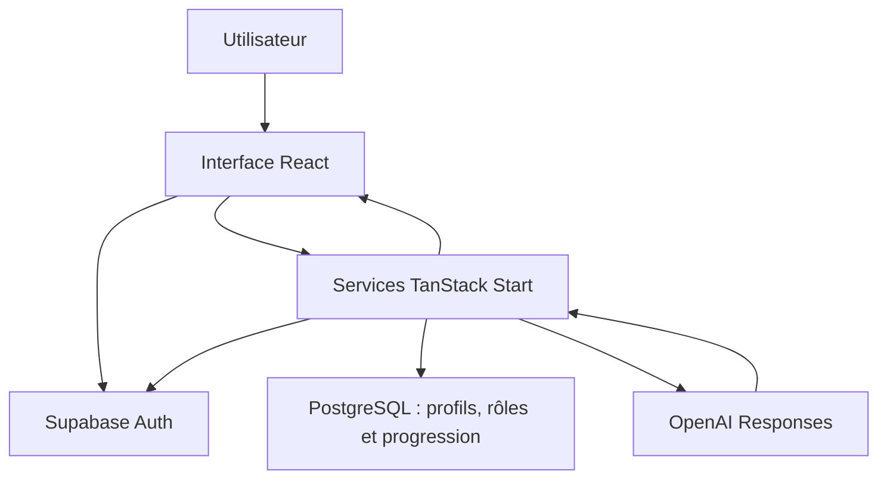
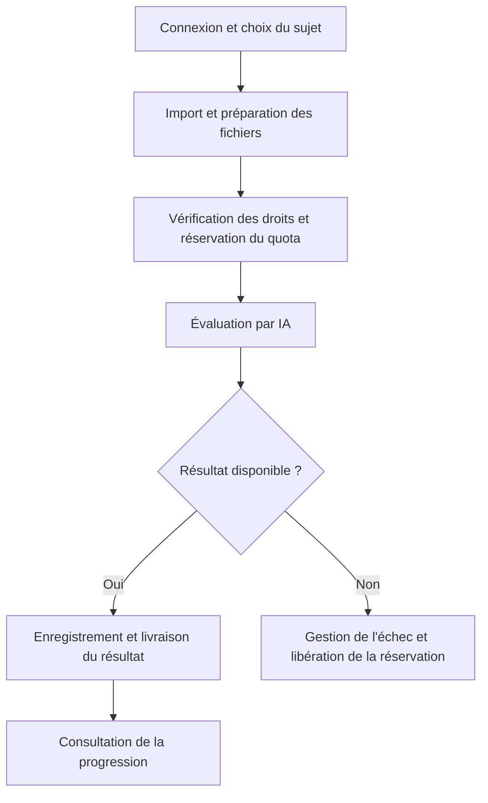

# EUF Pro

**Plateforme de préparation à l'Épreuve uniforme de français (ÉUF) du Québec.**

EUF Pro accompagne la pratique de la dissertation avec des sujets, des extraits de lecture, une évaluation assistée par IA et un suivi de progression. L'application accepte des photos et des PDF et propose des explications en français, espagnol et arabe. Les textes d'examen restent en français.

**Auteur du projet : [Larry Jack Gómez Casalins](https://github.com/Jackfm54)**
Projet personnel de développement web full-stack et d'intégration de l'intelligence artificielle.

## Contribution personnelle

Mon travail porte sur :

- La conception de l'architecture et des flux de navigation et de traitement de l'application.
- La conception de la base de données, des profils utilisateurs, des rôles et du suivi individuel.
- La conception de la logique d'IA applicative : consignes, critères d'évaluation, orchestration des appels et traitement des réponses.
- Le développement du code des interfaces et des services applicatifs.
- La rédaction de la documentation technique et des procédures de configuration et de déploiement.

Les modèles de langage sont fournis par OpenAI. La contribution IA décrite ici concerne leur intégration et la logique métier de l'application ; ce dépôt ne documente pas l'entraînement d'un modèle de fondation propriétaire.

## Fonctionnalités

- Inscription, confirmation par courriel, connexion et récupération de mot de passe.
- Profils et rôles, avec vérification des permissions côté serveur.
- Sujets et extraits de lecture, guide de préparation et règles de l'épreuve.
- Import de photos ou de PDF pour une évaluation pédagogique de la rédaction.
- Orientation par un professeur virtuel de littérature, soumise aux droits d'accès du compte.
- Historique, brouillons et progression enregistrés dans Supabase.
- Gestion des quotas d'évaluation : réservation avant l'appel IA et suivi de la livraison du résultat.
- Interface en trois langues et ajout à l'écran d'accueil sur mobile, avec connexion Internet requise.

L'évaluation et le professeur donnent des indications pédagogiques sans fournir une dissertation réécrite. Les résultats ne constituent pas une correction officielle de l'ÉUF. Les offres payantes sont affichées comme à venir ; les paiements sont désactivés.

## Architecture technique

| Couche | Technologies et responsabilité |
|---|---|
| Interface | React, TypeScript, Tailwind CSS et composants Radix UI |
| Navigation et serveur | TanStack Start, TanStack Router, Vite et Nitro |
| Identité et données | Supabase Auth et PostgreSQL, politiques RLS et contrôles serveur |
| Intelligence artificielle | OpenAI Responses, fournisseur chargé côté serveur |
| Validation | Tests Bun dans `src/lib` |
| Déploiement | Serveur Node.js, Docker ou configuration Vercel |



## Flux d'une évaluation



## Organisation du dépôt

| Emplacement | Contenu |
|---|---|
| `src/routes` | Pages, parcours publics et parcours authentifiés |
| `src/components` | Interface, authentification et gestion des langues |
| `src/lib` | Évaluation, professeur, quotas, progression et tests |
| `src/integrations/supabase` | Clients et contrôles d'accès |
| `src/data` | Sujets et guide de préparation |
| `ESQUEMA_BASE_DATOS.sql` | Schéma SQL et règles d'accès |
| `GUIA_DESPLIEGUE.md` | Guide de déploiement détaillé en espagnol |

Le schéma comprend notamment `profiles`, `user_roles`, `progress_records`, `evaluation_usage`, `evaluation_allowances` et `professor_entitlements`.

## Installation locale

Prérequis du projet : Node.js 24 et Bun 1.3.3, un projet Supabase et une clé d'API OpenAI pour les fonctionnalités IA.

```sh
git clone https://github.com/Jackfm54/euf-pro.git
cd euf-pro
bun install
cp .env.example .env
```

1. Renseigner les variables du fichier `.env`.
2. Installer le schéma `ESQUEMA_BASE_DATOS.sql` dans le projet Supabase prévu pour l'application. Examiner le script avant de l'appliquer à une base existante.
3. Configurer la confirmation par courriel et les URL de redirection dans Supabase Auth.
4. Lancer le serveur :

```sh
bun run dev
```

### Variables d'environnement

| Variable | Utilisation |
|---|---|
| `VITE_SUPABASE_URL` | URL publique du projet Supabase |
| `VITE_SUPABASE_PUBLISHABLE_KEY` | Clé publique du navigateur |
| `SUPABASE_URL` | URL du même projet côté serveur |
| `SUPABASE_PUBLISHABLE_KEY` | Clé publique utilisée côté serveur |
| `SUPABASE_SERVICE_ROLE_KEY` | Clé privilégiée, exclusivement côté serveur |
| `OPENAI_API_KEY` | Clé OpenAI, exclusivement côté serveur |
| `AI_MODEL` | Modèle d'évaluation ; valeur par défaut du code : `gpt-4o-mini` |
| `CRON_SECRET` | Secret des opérations serveur protégées concernées |
| `NITRO_PRESET` | `node_server` par défaut, `vercel` pour Vercel |

Ne jamais publier `.env` ni mettre une clé privée dans une variable préfixée par `VITE_`.

## Tests et production

```sh
bun run test
bun run build
bun run start
```

Les tests couvrent notamment le fournisseur IA, la livraison des évaluations, l'accès au professeur, les traductions et les limites de fichiers. Leur présence ne remplace pas une validation réelle de l'authentification, des courriels et des appels IA dans l'environnement déployé.

Pour Vercel, définir `NITRO_PRESET=vercel`. Pour un serveur Node.js, le port par défaut est 3000 ; `PORT` et `HOST` sont configurables. Consulter le [guide de déploiement](GUIA_DESPLIEGUE.md).

## État et limites

- Les paiements ne sont pas activés et les droits du professeur sont contrôlés côté serveur.
- Les photos sont redimensionnées dans le navigateur avec un côté maximal de 1 600 pixels ; les PDF sont limités à 3 Mio et la taille totale encodée de l'envoi est contrôlée.
- Les documents volumineux nécessitent un parcours adapté ; l'application ne propose pas d'envoi de taille illimitée.
- L'installation mobile repose sur un manifeste, sans service worker ni mode hors connexion.
- La qualité des résultats IA dépend de la lisibilité du document et du modèle utilisé.
- L'exploitation nécessite de configurer les services externes et de vérifier les parcours de bout en bout. Ce README ne certifie pas un déploiement en production.

## Ressources tierces

Les modèles OpenAI, les bibliothèques et les textes d'examen restent soumis aux conditions et droits de leurs fournisseurs ou auteurs respectifs. La présentation de ce projet personnel n'attribue pas à son auteur la création de ces ressources.

- La evaluación consume saldo de OpenAI, facturado aparte del alojamiento.
- Los pagos están desactivados; los planes se muestran como «Próximamente».
- Vercel limita a 4,5 MB cada solicitud a sus funciones: las fotos o PDF muy grandes deben adaptarse a un almacenamiento privado antes de publicar (pendiente).
- La instalación móvil usa un manifiesto; no hay funcionamiento sin conexión.
